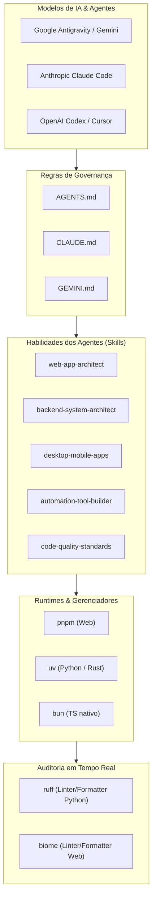

<div align="center">

# ⚡ Antigravity & AI Agent Vibe Coding Toolkit

### O ecossistema definitivo para desenvolvimento em alta velocidade assistido por IA.
Projetado para **Google Antigravity**, **Anthropic Claude Code**, **OpenAI Codex**, **Cursor** e **Windsurf**.

[](https://github.com/PowerShell/PowerShell)
[](https://nodejs.org/)
[](https://python.org/)
[](https://www.rust-lang.org/)
[](https://bun.sh/)
[](https://github.com/astral-sh/uv)
[](https://github.com/astral-sh/ruff)
[](https://biomejs.dev/)
[](LICENSE)

</div>

---

## 🌟 Visão Geral

Este repositório consolida uma **estação de trabalho completa de engenharia de software e "Vibe Coding"**. Ele equipa tanto o desenvolvedor humano quanto os agentes autônomos de IA com ferramentas que resolvem dependências em milissegundos, geram interfaces espetaculares, garantem código limpo e eliminam qualquer atrito no ciclo de desenvolvimento.

Compatível nativamente com:
- **Google Antigravity & Gemini CLI** (via `GEMINI.md` e diretrizes de Skills).
- **Anthropic Claude Code** (via `CLAUDE.md`).
- **OpenAI Codex, Cursor e Windsurf** (via `AGENTS.md`).

---

## 🏗️ Arquitetura do Ecossistema



---

## 🚀 Instalação Rápida (Modular & Interativa)

Para configurar qualquer máquina Windows do zero com todas as ferramentas, binários Rust, scripts e perfis de console:

1. Clone o repositório:
   ```powershell
   git clone https://github.com/Mattttfb/antigravity-vibe-coding-toolkit.git
   cd antigravity-vibe-coding-toolkit
   ```
2. Escolha o modo de instalação que preferir:
   ```powershell
   # Instalação completa padrão (Recomendado):
   powershell -ExecutionPolicy Bypass -File .\setup.ps1

   # Modo Interativo (escolha manualmente o que quer instalar):
   powershell -ExecutionPolicy Bypass -File .\setup.ps1 -Interactive

   # Instalação apenas para Frontend / Web:
   powershell -ExecutionPolicy Bypass -File .\setup.ps1 -Profile FrontendOnly

   # Instalação apenas para Backend / APIs:
   powershell -ExecutionPolicy Bypass -File .\setup.ps1 -Profile BackendOnly
   ```

---

## 🔔 Notificações & Atualizações

### Como ser notificado de novas versões:
- No GitHub, clique no botão **Watch** (no topo da página) $\rightarrow$ selecione **Custom** $\rightarrow$ marque **Releases**. O GitHub avisará por e-mail e no app sempre que uma nova versão do Toolkit for lançada.
- No terminal do PowerShell 7, basta digitar `check-toolkit-update` a qualquer momento para checar novidades.

### 🔄 Como Atualizar ou Escolher Versões:
```powershell
# 1. Atualizar para a versão mais recente:
powershell -ExecutionPolicy Bypass -File .\update.ps1

# 2. Atualização Interativa (escolha o que quer atualizar):
powershell -ExecutionPolicy Bypass -File .\update.ps1 -Interactive

# 3. Voltar ou fixar em uma versão específica (ex: v1.0.0):
powershell -ExecutionPolicy Bypass -File .\update.ps1 -Version v1.0.0
```

---

## 🛠️ Ferramentas Integradas e Suas Funções

### 1. Velocidade Extrema e Runtimes
* **`uv` (v0.13.8 - Astral):** Gerenciador de pacotes Python em Rust. Resolve dependências 10-100x mais rápido que o pip.
* **`pnpm` (v12.18.0):** Gerenciador de pacotes eficiente para projetos React, Next.js e monorepos.
* **`Bun` (v1.4.4):** Runtime JavaScript/TypeScript que executa arquivos `.ts` diretamente em ~10ms.
* **`Cargo / Rust` (v1.99.1):** Habilita compilação de aplicativos desktop nativos ultraleves com **Tauri**.

### 2. Formatadores e Linters em Rust
* **`ruff` (v0.17.5):** O linter e formatador mais rápido do mundo para Python.
* **`biome` (v2.6.7):** Substituto all-in-one para ESLint e Prettier para JavaScript/TypeScript/CSS.

### 3. Modern Unix & Produtividade no Terminal
* **`ripgrep` (`rg` v14.1.1):** Busca instantânea de texto e código em projetos com milhões de linhas.
* **`jq` (v1.7.1):** O processador de JSON definitivo para linha de comando.
* **`bat` (v0.25.0):** Clone do `cat` com syntax highlighting colorido e integração com Git.
* **`fd` (v10.2.0):** Localizador de arquivos simples e rápido.
* **`tldr` (v3.5.0):** Cheatsheets comunitários com exemplos práticos de uso para qualquer comando.
* **`lazygit` (`lg` v0.44.1):** Interface gráfica de Git para terminal.
* **`httpie` (`http` v3.2.4):** Cliente REST para testar APIs com JSON colorido.

### 4. Banco de Dados, Mock Data & Rede
* **`sqlite-utils` (v4.2.1):** Manipulação, queries e auditoria de bancos SQLite via terminal.
* **`faker` (v40.54.0):** Geração de dados realistas brasileiros (`pt_BR`) para testes e visualização de dashboards.
* **`supabase CLI` (v3.1.0):** Orquestração de backends PostgreSQL, autenticação e storage locais.
* **`localtunnel` (`lt`):** Exposição imediata de portas locais com HTTPS para testes no smartphone ou webhooks.

---

## 🧠 Skills de Engenharia Inclusas

Localizadas na pasta `skills/`:

| Skill | Escopo |
| :--- | :--- |
| **`web-app-architect`** | Criação de frontends modernos com Vite, React, Next.js 15, Tailwind CSS, Shadcn UI, Magic UI e Aceternity UI. |
| **`backend-system-architect`** | APIs assíncronas com FastAPI/Node, autenticação, CORS e persistência SQLite/PostgreSQL. |
| **`desktop-mobile-apps`** | Apps nativos para Windows/Mac/Linux com **Tauri** (Rust + React) e Android com Jetpack Compose. |
| **`automation-tool-builder`** | Utilitários CLI com Typer/Rich, scripts com `uv` e scripts TypeScript imediatos via `bun`. |
| **`code-quality-standards`** | Clean Architecture, Conventional Commits, tipagem estrita e segurança OWASP Top 10. |

---

## 🧰 Toolkit de Automação (`scripts/dev-toolkit/`)

* **`scaffold.py` & `scaffold.ps1`:** Bootstrap imediato de projetos (`fastapi`, `vite-react`, `nextjs`, `python-cli`, `tauri`) já injetando as regras `AGENTS.md`.
* **`seed_data.py`:** Gerador de dados de teste sob demanda (usuários brasileiros, produtos de e-commerce, métricas para gráficos e posts).
* **`tunnel.py`:** Criação de túnel público HTTPS com 1 comando (`python tunnel.py 8000`).
* **`get_gitignore.py`:** Baixa o `.gitignore` oficial do GitHub para qualquer stack.
* **`docker-compose-postgres.yml` & `docker-compose-redis.yml`:** Templates prontos para subir PostgreSQL 16 com pgAdmin e Redis 7 com Redis Commander.

---

## ⌨️ Atalhos do PowerShell 7

Ao abrir o **PowerShell 7 (`pwsh`)**, você tem os seguintes comandos à mão:

```bash
scaffold-api ./minha-api "Nome"     # Cria API FastAPI completa com SQLite
scaffold-web ./meu-site             # Cria Frontend React + Vite + Tailwind
scaffold-cli ./meu-cli "Nome"       # Cria ferramenta de linha de comando com Typer
seed-data users 20 -Out users.json  # Gera 20 usuários brasileiros com avatares
tunnel 8000                         # Expõe a porta 8000 para a internet via HTTPS
get-gitignore python node           # Baixa o .gitignore oficial da comunidade
lg                                  # Abre o LazyGit
gs / gl / gp / gpl                  # Atalhos rápidos de Git (status, log, push, pull)
```

---

## 🛡️ Princípios de "Vibe Coding" & Comportamento da IA

1. **Separação Rígida de Dados:** O código de produção sempre consome modelos e APIs reais. Dados fictícios (`faker`) vivem estritamente em scripts de seed e nunca são hardcodados no código final.
2. **Clean Architecture:** Separação estrita em camadas (Rotas $\rightarrow$ Services $\rightarrow$ Repositories).
3. **Autoverificação:** O agente sempre executa `ruff` ou `biome` antes de concluir a entrega.
4. **Segurança:** Obrigatório `.env.example`, `.gitignore` e queries parametrizadas.

---

## 💖 Créditos e Agradecimentos

Este ecossistema foi construído integrando as melhores contribuições de grandes empresas de tecnologia e projetos open-source de renome mundial:

* **[Google](https://developers.google.com/):** Pelo ecossistema Android, Chrome DevTools, Firebase e as diretrizes do Google Antigravity & Gemini.
* **[Anthropic](https://www.anthropic.com/):** Pela especificação e padronização aberta do [Model Context Protocol (MCP)](https://modelcontextprotocol.io/).
* **[Astral](https://astral.sh/):** Pelos revolucionários **[uv](https://github.com/astral-sh/uv)** e **[ruff](https://github.com/astral-sh/ruff)**.
* **[Vercel](https://vercel.com/):** Pelo [Next.js](https://nextjs.org/) e o [Vercel AI SDK](https://sdk.vercel.ai/).
* **[Supabase](https://supabase.com/):** Pela plataforma aberta de backend e o [Supabase CLI](https://github.com/supabase/cli).
* **[Shadcn](https://ui.shadcn.com/):** Pelo ecossistema de componentes e arquitetura de registros aberta.
* **[Magic UI](https://magicui.design/):** Pelos blocos visuais animados de alta fidelidade.
* **[Aceternity UI](https://ui.aceternity.com/):** Pelos componentes visuais e efeitos modernos de Vibe Coding.
* **[21st.dev](https://21st.dev/):** Pelo registro comunitário global de componentes de Design Engineers.
* **[tldr-pages](https://github.com/tldr-pages/tldr):** Pelo maior catálogo aberto de exemplos práticos de terminal do mundo.
* **[BurntSushi (ripgrep)](https://github.com/BurntSushi/ripgrep):** Pelo mecanismo de busca em código ultrarrápido.
* **[sharkdp (bat & fd)](https://github.com/sharkdp):** Pelas ferramentas essenciais do Modern Unix em Rust.
* **[jqlang (jq)](https://github.com/jqlang/jq):** Pelo padrão mundial de manipulação de JSON no terminal.
* **[Jesse Duffield (lazygit)](https://github.com/jesseduffield/lazygit):** Pela interface de terminal do Git.
* **[Joke2k (Faker)](https://github.com/joke2k/faker):** Pela geração de dados de teste realistas.
* **[PatrickJS & bmadcode](https://github.com/PatrickJS/awesome-cursorrules):** Pela compilação comunitária de regras de ouro para agentes de IA.

---

<div align="center">
  <sub>Desenvolvido com paixão para a nova era do desenvolvimento assistido por IA.</sub>
</div>
